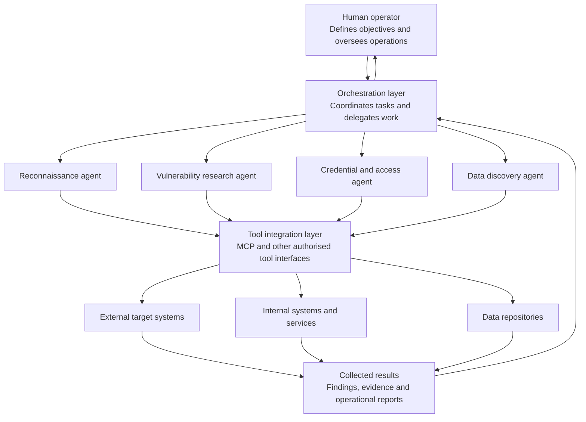

# GTG-1002 — Reported AI-Agent Architecture

## Purpose

This diagram illustrates the AI-enabled operational model described in Anthropic's November 2025 reporting on the GTG-1002 campaign.

It is a conceptual representation of the reported workflow. It does not claim to reproduce the exact internal architecture, agent configuration or infrastructure used by the threat actor.

## Conceptual architecture

## Architecture interpretation

Anthropic reported that the operation used Claude Code, Model Context Protocol (MCP) tools and specialised AI agents to support different operational tasks.

The conceptual model highlights five components:

1. **Human operator:** Provides objectives, direction and oversight.
2. **Orchestration layer:** Coordinates tasks and delegates work between agents.
3. **Specialised agents:** Support activities such as reconnaissance, vulnerability research, credential collection and data discovery.
4. **Tool integration layer:** Connects AI workflows to external tools and systems. Anthropic specifically reported the use of MCP.
5. **Results and feedback:** Operational findings are returned for further analysis and task coordination.

## Security implications

This architecture introduces several important security considerations:

- Excessive permissions granted to AI agents or connected tools.
- Inadequate separation between agent tasks and privileges.
- Insufficient logging of tool calls and agent activity.
- Trust in AI-generated findings without independent verification.
- Potential for rapid escalation when multiple agents coordinate activities.
- Difficulty distinguishing legitimate automation from malicious activity.

## Analytical limitation

The diagram is an interpretation of Anthropic's published description. The specific agent boundaries, communication paths and feedback loops are illustrative, not confirmed implementation details.

## Source

Anthropic. (2025, November 13). *Disrupting the first reported AI-orchestrated cyber espionage campaign.*

https://www.anthropic.com/news/disrupting-AI-espionage
