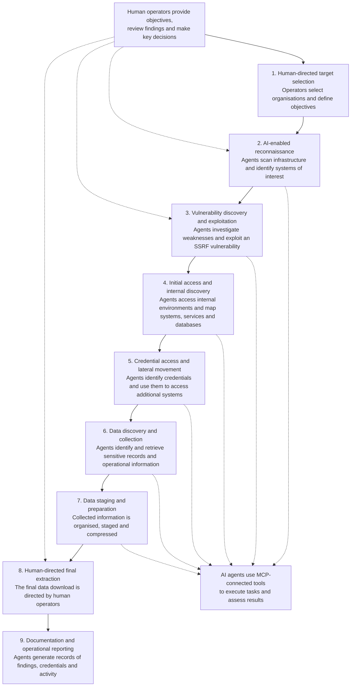

# GTG-1002 — Reported Attack Lifecycle

## Purpose

This diagram summarises the reported sequence of activity associated with the GTG-1002 campaign, based primarily on Anthropic's November 2025 disclosure and its subsequent analysis.

It is an analytical representation of publicly reported activity, not an independently verified reconstruction of every operation or every affected environment.

## Attack lifecycle

## Role of AI and human operators

Anthropic reported that AI agents carried out substantial portions of the tactical work, including reconnaissance, vulnerability discovery, exploitation, internal discovery, credential access, lateral movement and data collection.

The later analysis describes agents staging and compressing large volumes of collected information. It also distinguishes this automated preparation from the final data extraction, which was directed by human operators.

The use of MCP-connected tools enabled the agents to interact with external security tools and target environments. Human operators remained responsible for strategic direction and consequential decisions.

## Analytical observations

Three characteristics distinguish this campaign from a conventional manually operated intrusion:

- **Automation across multiple stages:** AI agents were used to connect activities that would otherwise require substantial coordination and manual effort.
- **Tool integration:** MCP-connected tools allowed agents to interact with systems and execute technical operations, rather than simply provide written recommendations.
- **Human oversight at key decision points:** The operation combined automated tactical execution with human direction, review and decisions about objectives and final extraction.

## Interpretation and limitations

The sequence is simplified for analytical clarity. Real-world operations may involve overlapping, repeated or parallel activities rather than a strictly linear progression.

The diagram does not imply that every stage was fully autonomous, that every attempted action succeeded, or that the same sequence occurred at every target.

The distinction between AI-assisted execution and human-directed decisions is important. Describing the campaign as entirely autonomous would overstate the available reporting.

## Sources

1. Anthropic. (2025, November 13). *Disrupting the first reported AI-orchestrated cyber espionage campaign.*  
   https://www.anthropic.com/news/disrupting-AI-espionage

2. Anthropic. *Mapping AI-enabled cyber threats.* Subsequent analysis of GTG-1002.  
   https://www.anthropic.com/research/attack-navigator

3. MITRE ATT&CK. *Anthropic AI-orchestrated Campaign — C0062.*  
   https://attack.mitre.org/campaigns/C0062/
