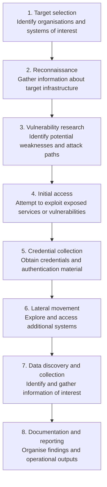

# GTG-1002 — Reported Attack Lifecycle

## Purpose

This diagram summarises the attack lifecycle described in Anthropic's November 2025 reporting on the GTG-1002 campaign.

It is an analytical representation of the reported sequence, not an independently verified reconstruction of every operation.

## Attack lifecycle

## Role of AI in the reported campaign

Anthropic reported that AI agents supported activities across multiple stages, including reconnaissance, vulnerability research, exploitation, credential collection and data gathering.

The diagram does not imply that every stage was fully autonomous or that every operation succeeded. The extent of AI involvement is based on Anthropic's account.

## Analytical note

The campaign illustrates how AI-assisted workflows may compress the time and effort required to conduct multiple stages of a cyber operation. It also raises questions about human oversight, tool permissions, verification of AI-generated findings and the monitoring of agent activity.

## Source

Anthropic. (2025, November 13). *Disrupting the first reported AI-orchestrated cyber espionage campaign.*

https://www.anthropic.com/news/disrupting-AI-espionage
